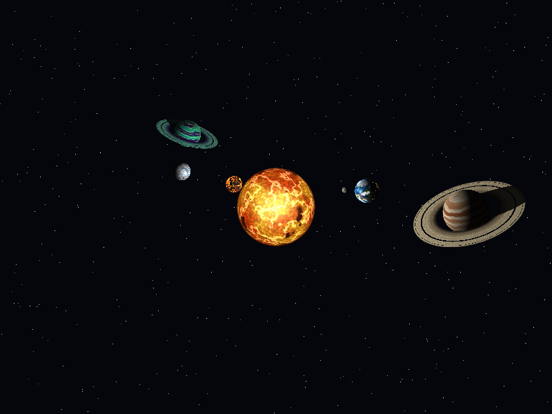
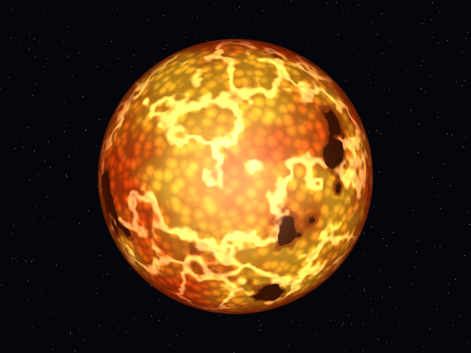
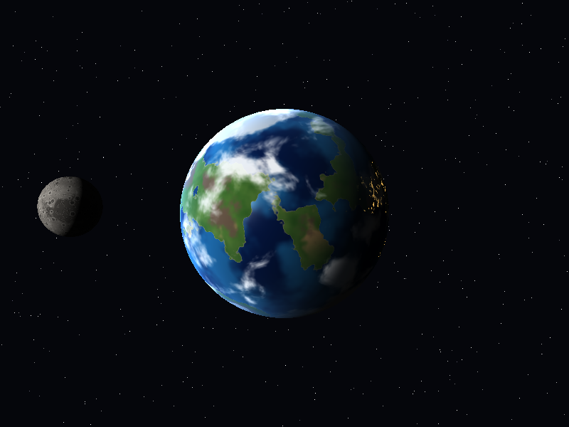
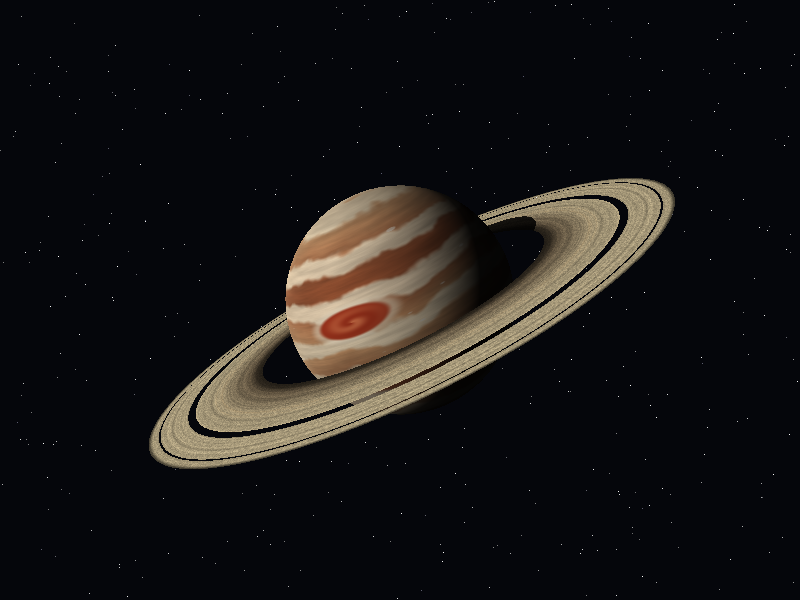
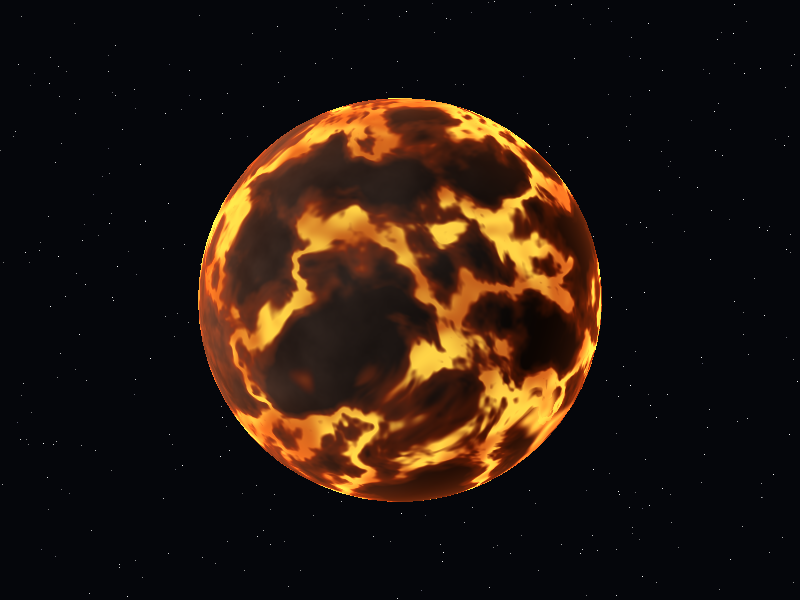
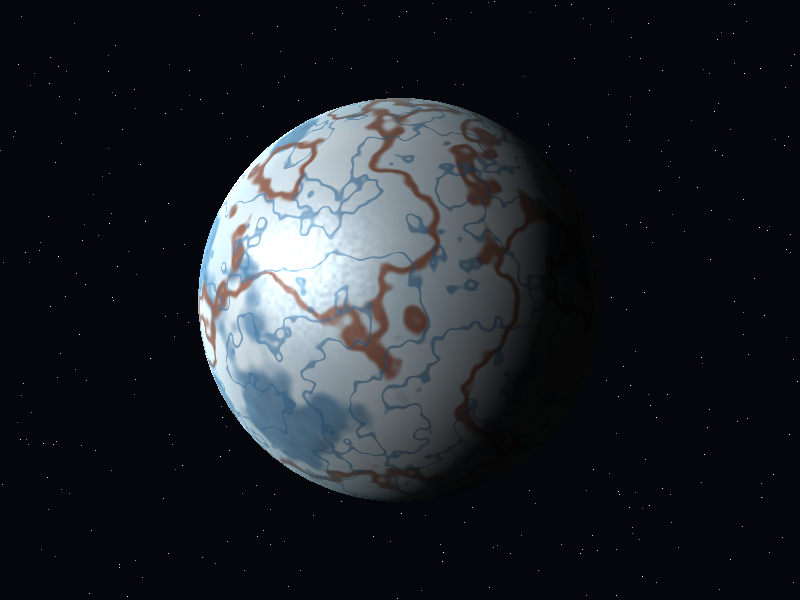
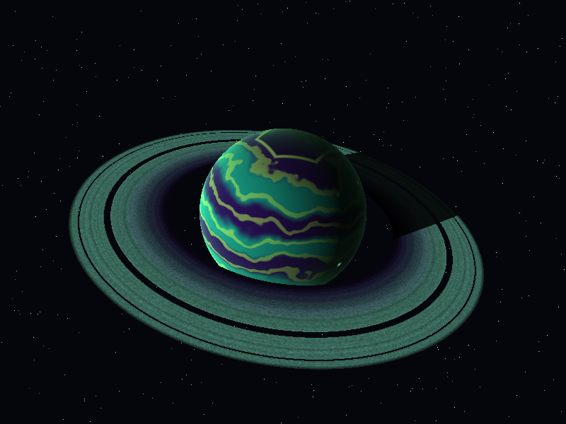

# Lab 5 - Shaders: Sistema solar procedural

Software renderer escrito desde cero en Rust que dibuja un sistema solar completo **usando únicamente shaders**: no hay texturas ni materiales. Todo el color de cada cuerpo celeste se calcula píxel por píxel en un fragment shader, a partir de la posición, la normal, la luz y el tiempo.

**Autor:** Julio Pellecer (241071) · Gráficas por Computadora · UVG



## Cómo ejecutarlo

```bash
cargo run --release
```

| Tecla | Acción |
|---|---|
| `1` | Helios (estrella) |
| `2` | Gaia-7 (planeta rocoso) + su luna Selene |
| `3` | Zephyros (gigante gaseoso) + anillos |
| `4` | Vulkara (planeta de lava) |
| `5` | Glacius (planeta helado) |
| `6` | Xyloth (gigante tóxico) + anillos |
| `0` | Sistema solar completo con rotación y traslación |
| `Espacio` | Pausar / reanudar |
| `↑` / `↓` | Acercar / alejar la cámara |
| `P` | Guardar captura `.bmp` |
| `Esc` | Salir |

Para regenerar todas las capturas sin abrir ventana: `cargo run --release -- --capturas`

## Pipeline del renderer

```
sphere.obj / ring.obj → vertex shader → rasterizador (baricéntricas) → z-buffer → fragment shader → framebuffer
```

| Archivo | Responsabilidad |
|---|---|
| `src/math.rs` | `Vec3`, matrices 4x4 (modelo, vista, perspectiva), `mix` y `smoothstep` |
| `src/noise.rs` | Ruido procedural: value noise, fBm, ruido de crestas y ruido celular |
| `src/obj.rs` | Carga de modelos `.obj` (vértices, normales y caras) |
| `src/triangle.rs` | Rasterización con coordenadas baricéntricas y prueba de profundidad |
| `src/framebuffer.rs` | Buffer de color + z-buffer y exportación a `.bmp` |
| `src/shaders.rs` | Vertex shader y los fragment shaders de cada cuerpo celeste |
| `src/main.rs` | Ventana, escenas, órbitas y controles |

Los anillos y la luna son **modelos separados** del planeta: los anillos usan `assets/ring.obj` (un disco plano) y la luna es otra instancia de `assets/sphere.obj` con su propia matriz de modelo y su propio shader.

## Cuerpos celestes y sus capas

### 1. Helios, la estrella



1. **Temperatura base:** fBm animado que mezcla naranja y amarillo.
2. **Granulación:** ruido celular para simular las celdas de convección.
3. **Manchas solares:** umbra y penumbra con dos umbrales de `smoothstep`.
4. **Fáculas y filamentos:** ruido de crestas que dibuja líneas de plasma brillante.
5. **Oscurecimiento del limbo:** el borde se ve más oscuro y rojizo, el centro casi blanco.

La estrella no usa iluminación externa: emite su propia luz y es la fuente de luz del sistema.

### 2. Gaia-7, el planeta rocoso, y su luna Selene



1. **Océano con profundidad:** fosas oscuras y aguas turquesa.
2. **Continentes y biomas:** playa, bosque, desierto ecuatorial, montañas y nieve según altura y latitud.
3. **Casquetes polares** con borde irregular.
4. **Iluminación** difusa con reflejo especular del sol solo en el agua.
5. **Luces de ciudades** que aparecen únicamente en el lado nocturno.
6. **Nubes animadas** que giran más rápido que la superficie.
7. **Atmósfera:** halo azul en el borde (efecto Fresnel).

**Selene (luna):** regolito, mares oscuros, cráteres de dos tamaños con fondo y borde, e iluminación dura sin atmósfera.

### 3. Zephyros, el gigante gaseoso con anillos



1. **Bandas latitudinales** deformadas con ruido (domain warping).
2. **Turbulencia:** vetas estiradas a lo largo de cada banda.
3. **Gran Mancha:** tormenta elíptica con espiral animada y halo claro.
4. **Óvalos blancos:** tormentas pequeñas generadas con ruido celular.
5. **Iluminación,** oscurecimiento del borde y bruma atmosférica.

**Anillos:** huecos de Cassini y Encke (píxeles descartados), color según el radio con bandas finas, densidad variable y granulado de partículas, **sombra del planeta proyectada sobre los anillos** (rayo hacia el sol) e iluminación por ambas caras.

### Extra 1. Vulkara, el planeta de lava



1. Corteza basáltica oscura.
2. Grietas de lava (ruido de crestas) y lagos de magma.
3. Lava pulsante que cambia de temperatura con el tiempo.
4. La corteza recibe luz y el magma emite la suya, así que brilla también de noche.
5. Halo de calor en el borde.

### Extra 2. Glacius, el planeta helado (inspirado en Europa)



1. Hielo base entre blanco y celeste.
2. Terreno caótico de bloques azul profundo.
3. *Lineae:* grietas rojizas largas y grietas azules finas.
4. Iluminación con destellos especulares del hielo.
5. Tenue atmósfera en el borde.

### Extra 3. Xyloth, el gigante tóxico con anillos (planeta inventado)



1. Bandas en remolino animadas en violeta, turquesa y verde ácido.
2. Hexágono polar giratorio, como el de Saturno.
3. Iluminación.
4. Relámpagos bioluminiscentes que parpadean en el lado nocturno.
5. Atmósfera verde venenosa en el borde.

Tiene su propio sistema de anillos con una paleta violeta y turquesa.

## Rotación y traslación (opcional)

En la vista `0`, cada planeta gira sobre su eje inclinado (rotación) y orbita alrededor de Helios (traslación). Selene orbita alrededor de Gaia-7 mientras Gaia-7 orbita al sol, y la luz de cada planeta sale de la posición real de la estrella.
